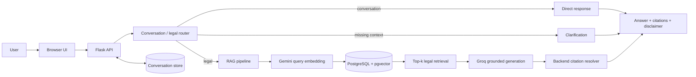
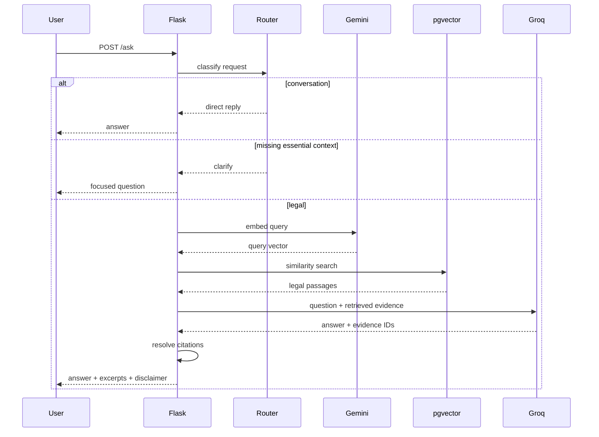

# AinBondhu : Bangladesh Criminal-Law Q&A Assistant

A source-grounded legal-information assistant for Bangladesh criminal procedure.

The application answers English-language questions using an indexed archive of the **Code of Criminal Procedure, 1898** and the **Evidence Act, 1872**. Legal answers are generated only after retrieval and include traceable section/page excerpts from the indexed sources.

The project focuses on:
- grounded answers instead of model-memory answers;
- section-level legal provenance;
- incremental, version-aware document ingestion;
- failure-focused evaluation and controlled experiments.

> **Legal information only; not legal advice.**  
> The indexed corpus is archival and is not certified as the complete current law of Bangladesh.

**Repository:** [GitHub](https://github.com/nahid2003131/ml-engineer-entry-assessment)  
**Live app:** [Railway deployment](https://ml-engineer-entry-assessment-production.up.railway.app)

---

## Assessment Deliverables

| # | Deliverable | Evidence |
|---|---|---|
| 1 | Git repository | [Repository](https://github.com/nahid2003131/ml-engineer-entry-assessment) |
| 2 | Functional web app / API | [Live app](https://ml-engineer-entry-assessment-production.up.railway.app), [`app.py`](app.py) |
| 3 | Legal ingestion / retrieval pipeline | [`ingest.py`](ingest.py), [`embed.py`](embed.py), [`rag.py`](rag.py) |
| 4 | Evaluation dataset / results | [`evaluation.json`](evaluation.json), [`EVALUATION.md`](EVALUATION.md), [`grounded-v0.4.json`](grounded-v0.4.json), [`grounded-v0.5.json`](grounded-v0.5.json) |
| 5 | Experiment / failure analysis | [`EXPERIMENTS.md`](EXPERIMENTS.md) |
| 6 | Incremental document-update demo | [`INCREMENTAL_UPDATE_DEMO.md`](INCREMENTAL_UPDATE_DEMO.md) |
| 7 | Documentation / architecture | This README |
| 8 | Meaningful Git history | Repository commit history |
| 9 | Deployment link | [Railway deployment](https://ml-engineer-entry-assessment-production.up.railway.app) |
| 10 | AI usage disclosure | [`AI_USAGE.md`](AI_USAGE.md) |

---

## System Overview

The active retrieval corpus contains **697 indexed legal section/range records**:

| Source | Records | Active source version |
|---|---:|---|
| Code of Criminal Procedure, 1898 | 515 | `crpc-old-bdlaws-archive-2026-09-17-v1` |
| Evidence Act, 1872 | 182 | `evidence-act-old-bdlaws-2023-12-03-v1` |
| **Total** | **697** | — |

Source provenance, hashes and scope are documented in [`documents/SOURCES.md`](documents/SOURCES.md). Machine-readable source configuration is in [`documents/sources.json`](documents/sources.json).

### Architecture



### Legal ingestion and retrieval

```mermaid
flowchart LR
    PDF[Legal PDFs] --> MANIFEST[documents/sources.json]
    MANIFEST --> CHECK[Validate hash / pages / source]
    CHECK --> PARSER[Parser profile]
    PARSER --> SECTIONS[Section / range records]
    SECTIONS --> DB[(legal_sections)]
    DB --> EMBED[Gemini document embeddings]
    EMBED --> VECTOR[(pgvector)]

    Q[Legal question] --> QEMBED[Gemini query embedding]
    QEMBED --> VECTOR
    VECTOR --> TOPK[Top-k sections]
    TOPK --> PROMPT[Grounded prompt]
    PROMPT --> LLM[Groq]
    LLM --> IDS[Evidence IDs]
    IDS --> RESOLVE[Resolve stored section/page/excerpt]
    RESOLVE --> ANSWER[Grounded answer]
```



### Request flow



Previous assistant messages may provide conversational context, but only retrieved legal text is treated as legal evidence.

---

## Technology

| Layer | Choice |
|---|---|
| Backend | Python 3.12 + Flask |
| Generation | Groq `openai/gpt-oss-120b` |
| Embeddings | Gemini `gemini-embedding-2`, 768 dimensions |
| Storage / vector search | PostgreSQL + pgvector |
| PDF extraction | Poppler + `pdfplumber` |
| Deployment | Railway + Gunicorn |

The model returns evidence IDs, while the backend resolves stored document names, section references, PDF pages and excerpts. This keeps citation metadata traceable and prevents model-written page references.

---

## Local Setup

### Prerequisites

- Python 3.12
- PostgreSQL with pgvector
- Poppler
- Groq API key
- Gemini API key

macOS:

```bash
brew install poppler
```

Debian / Ubuntu:

```bash
sudo apt-get install poppler-utils
```

Setup:

```bash
python3.12 -m venv .venv
.venv/bin/python -m pip install -r requirements.txt
cp -n .env.example .env
```

Required environment variables:

```env
GROQ_API_KEY=...
GROQ_MODEL=openai/gpt-oss-120b
GEMINI_API_KEY=...
DATABASE_URL=postgresql://...
PORT=8000
```

Do not commit `.env`.

---

## Run the App

```bash
make run
```

or:

```bash
python3 app.py
```

If port 5000 is occupied:

```bash
python3 -m flask --app app run --port 5001
```

Health check:

```bash
curl http://127.0.0.1:5001/health
```

Example legal request:

```bash
curl -X POST \
  http://127.0.0.1:5001/ask \
  -H "Content-Type: application/json" \
  -d '{"question":"Can I get a copy of the police report before the inquiry or trial starts?"}'
```

---

## API Behavior

### `POST /ask`

Request:

```json
{
  "question": "Can I get a copy of the police report?"
}
```

Grounded legal responses include:

```json
{
  "status": "answer",
  "answer": "...",
  "citations": [
    {
      "id": 1,
      "document": "crpc-1898-part-2.pdf",
      "section": "173",
      "pdf_pages": [99],
      "printed_pages": [137],
      "excerpt": "..."
    }
  ],
  "source_version": "...",
  "error": null,
  "disclaimer": "Legal information only; not legal advice. ..."
}
```

Statuses:

| Status | Meaning |
|---|---|
| `answer` | Supported answer returned |
| `clarify` | Essential context is missing |
| `insufficient_evidence` | Indexed sources cannot support the request |
| `error` | Provider, retrieval, data or validation failure |

The legal path does not silently fall back to general legal knowledge when retrieval fails.

---

## Source Management and Incremental Updates

Source configuration lives in [`documents/sources.json`](documents/sources.json).

The ingestion flow supports:

```bash
python3 ingest.py --check
python3 ingest.py --diff
python3 ingest.py --load
```

`--diff` reports document and section changes, including which embeddings need regeneration.

### Evidence Act update demonstration

The Evidence Act was added without rebuilding unchanged CrPC data:

```text
Documents:
added=1
changed=0
unchanged=4

Sections:
added=182
content_changed=0
metadata_changed=0
removed=0
unchanged=515

Embeddings requiring refresh:
182
```

After loading:

```text
source_documents = 5
legal_sections   = 697
```

The existing 515 CrPC records and reusable embeddings were preserved.

Full walkthrough: [`INCREMENTAL_UPDATE_DEMO.md`](INCREMENTAL_UPDATE_DEMO.md).

---

## Embeddings and Retrieval

Check embedding state:

```bash
python3 embed.py --check
```

Generate only missing/outdated embeddings:

```bash
python3 embed.py --load
```

Current state:

```text
Sections: 697
Reusable embeddings: 697
Embeddings to generate: 0
```

Smoke test:

```bash
python3 embed.py --search \
  "What does the Evidence Act say about confessions made to a police officer?"
```

This retrieves Evidence Act Section 25 among the strongest matches.

### Why section-aware retrieval?

Legal rules often depend on provisos, cross-references and subsection boundaries. Arbitrary fixed-size chunks can separate a rule from the language that limits it.

This project therefore retrieves whole legal sections/ranges with their source-page metadata.

Current retrieval configuration:
- Gemini query embeddings;
- pgvector similarity search;
- `top_k = 5`;
- 16,000-character evidence budget;
- complete sections included as evidence units.

Hybrid search and reranking are not claimed as implemented features.

---

## Current-Law and Amendment Handling

The project tracks source versions, but the archive is **not certified as complete current law**.

A source downloaded in 2026 is not automatically treated as proof that every amendment through 2026 has been verified.

For questions asking for:
- current law;
- latest amendments;
- current-year values;
- current fines or deadlines;

the grounded prompt is instructed not to present an archived value as verified current law unless the retrieved evidence establishes currentness.

This behavior is tested directly in the evaluation set.

---

## Evaluation

The frozen development set is [`evaluation.json`](evaluation.json) and contains 20 cases covering:
- direct legal questions;
- multi-part rules;
- conditions and exceptions;
- ambiguous questions;
- unsupported questions;
- current-law/version-sensitive questions;
- case-specific status requests;
- citation support.

Run:

```bash
python3 evaluate.py \
  --mode grounded \
  --output grounded-next.json \
  --limit 20 \
  --delay 30
```

The runner records responses, retrieved evidence, evidence IDs, latency, model usage and configuration/source hashes. Existing result files are not silently overwritten.

Detailed methodology and case review: [`EVALUATION.md`](EVALUATION.md).

### Metrics are separated intentionally

- **Retrieval success:** was the expected provision retrieved?
- **Citation provenance:** is the citation a real retrieved source?
- **Semantic citation support:** does that source support the claim?
- **Required-point coverage:** were all material conditions preserved?
- **Behavior correctness:** did the system answer, clarify or abstain appropriately?

A valid excerpt alone does not make an answer correct.

---

## Results

### v0.4 baseline

| Metric | Result |
|---|---:|
| HTTP delivery | 20/20 (100%) |
| Expected behavior | 15/20 (75.00%) |
| Strict answer correctness | 9/14 (64.29%) |
| Required-point coverage | 30/42 (71.43%) |
| Gold evidence retrieval | 13/14 (92.86%) |
| Citation quote validity | 27/27 (100%) |
| Answer-level groundedness | 13/18 (72.22%) |
| Semantic citation support | 11/18 (61.11%) |
| Strict answers + supporting citation | 7/14 (50.00%) |
| Mean latency | 6.092 s |

Raw run: [`grounded-v0.4.json`](grounded-v0.4.json)

### v0.5 prompt experiment

The v0.5 experiment changed only the grounded-generation instruction in [`rag.py`](rag.py). Retrieval, embeddings, corpus, model, database and evaluator remained unchanged.

| Metric | v0.4 | v0.5 |
|---|---:|---:|
| HTTP delivery | 20/20 | 20/20 |
| Expected behavior | 15/20 (75.00%) | **16/20 (80.00%)** |
| Strict answer correctness | 9/14 (64.29%) | **9/14 (64.29%)** |
| Required-point coverage | 30/42 (71.43%) | **30/42 (71.43%)** |
| Gold evidence retrieval | 13/14 (92.86%) | **13/14 (92.86%)** |
| Strict answers + supporting citation | 7/14 (50.00%) | **8/14 (57.14%)** |
| Mean latency | 6.092 s | **6.050 s** |
| Total tokens | 67,470 | **70,882** |

Raw run: [`grounded-v0.5.json`](grounded-v0.5.json)

The result is not presented as a general accuracy improvement. It improved some grounding behavior, current-law caution and citation selection while strict correctness remained flat.

Full experiment report: [`EXPERIMENTS.md`](EXPERIMENTS.md).

---

## Failure Analysis

Observed remaining failure classes include:

| Failure class | Example issue |
|---|---|
| Lost qualifications | Multi-part rules can be compressed |
| Wrong law attribution | Cross-references can confuse statute identity |
| Citation semantic mismatch | A valid retrieved passage may not support the final claim |
| Historical provenance | Amendment footnotes are not first-class retrieval records |
| Ambiguity routing | Some underspecified questions are answered instead of clarified |
| Case-status requests | The statutory corpus cannot know live filing status |
| Current-law verification | Archived text may not establish the latest operative rule |

These are documented case-by-case in [`EVALUATION.md`](EVALUATION.md) and [`EXPERIMENTS.md`](EXPERIMENTS.md).

A two-pass LLM evidence-audit approach was also tested and rejected because the additional model call caused provider quota pressure. The retained v0.5 experiment uses a stricter single-pass grounded prompt.

---

## Conversation Persistence

Conversation storage is implemented in [`chat_store.py`](chat_store.py).

Recent chat history may be used to resolve follow-up wording, but it is never treated as legal evidence:

```text
conversation history = context
retrieved legal text  = evidence
```

The application does not provide user authentication or live court-record access.

---

## Testing

Offline tests:

```bash
python3 -m unittest test_rag -v
```

Read-only checks:

```bash
python3 ingest.py --check
python3 embed.py --check
```

These checks validate software and data consistency; they do not certify the archive as complete current law.

---

## Key Files

| File | Purpose |
|---|---|
| [`app.py`](app.py) | Flask API, routing and orchestration |
| [`rag.py`](rag.py) | Retrieval, grounding prompt and citation resolution |
| [`chat_store.py`](chat_store.py) | Conversation persistence |
| [`ingest.py`](ingest.py) | Source validation, parsing, diff and loading |
| [`embed.py`](embed.py) | Embedding generation/reuse and search |
| [`evaluate.py`](evaluate.py) | Evaluation runner |
| [`evaluation.json`](evaluation.json) | Frozen 20-case evaluation set |
| [`EVALUATION.md`](EVALUATION.md) | Evaluation methodology and review |
| [`EXPERIMENTS.md`](EXPERIMENTS.md) | Experiment and failure analysis |
| [`INCREMENTAL_UPDATE_DEMO.md`](INCREMENTAL_UPDATE_DEMO.md) | Document-update demonstration |
| [`AI_USAGE.md`](AI_USAGE.md) | AI usage disclosure |
| [`documents/sources.json`](documents/sources.json) | Machine-readable source manifest |
| [`documents/SOURCES.md`](documents/SOURCES.md) | Source provenance |
| [`grounded-v0.4.json`](grounded-v0.4.json) | Baseline run |
| [`grounded-v0.5.json`](grounded-v0.5.json) | Prompt experiment run |

---

## Known Limitations

- The corpus is archival, not a certified current-law database.
- Current amendments are not fully verified.
- The evaluation set is small and development-oriented.
- Retrieval is semantic vector top-k only.
- Amendment footnotes are not first-class retrieval records.
- The model can still omit material qualifications.
- Citation provenance is deterministic, but semantic support is not automatically guaranteed.
- Some ambiguity and case-status routing failures remain.
- There is no live court-record integration or user authentication.
- Provider quotas can temporarily affect generation.

---

## Responsible Use

This application is a legal-information prototype and engineering assessment. It is not a substitute for a lawyer, an official consolidated statute, verified amendment research or court records.

For important legal questions, users should verify the result against current official sources.

---

## Documentation

- [`EVALUATION.md`](EVALUATION.md) — evaluation methodology and results
- [`EXPERIMENTS.md`](EXPERIMENTS.md) — controlled experiments and failure analysis
- [`INCREMENTAL_UPDATE_DEMO.md`](INCREMENTAL_UPDATE_DEMO.md) — incremental source updates
- [`documents/SOURCES.md`](documents/SOURCES.md) — source provenance and hashes
- [`AI_USAGE.md`](AI_USAGE.md) — AI usage disclosure
