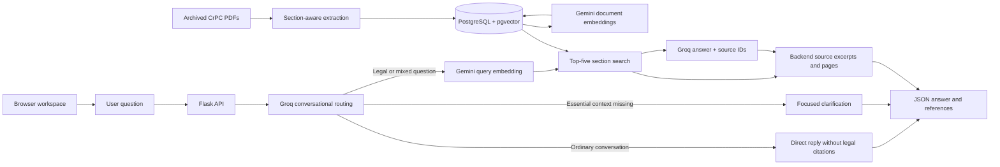

# Bangladesh criminal-law assistant

A backend-first English Q&A project using archived Bangladesh Code of Criminal
Procedure PDFs. It retrieves legal passages and returns an answer with section,
page and source excerpts. It provides legal information, not legal advice.

Current state: a white-theme browser workspace, Flask API and hosted retrieval are
implemented. Verified amendments, a document-update demonstration and app deployment are pending.
The latest run returned 20/20 responses; answer and reference quality still need work.

## Quick commands

Run from this repository folder:

```bash
make setup       # First-time environment/dependency setup; preserves existing .env
make run         # Start the API using local .env settings
make test        # Offline tests
make check       # Read-only PDF/database checks
make evaluate    # New run saved to grounded-next.json
```

If another server is already running, stop it with Ctrl+C before `make run`, or use
`make run PORT=8001`. `make evaluate OUTPUT=my-run.json` selects another result file;
existing results are protected. `make ingest` and `make embed` load a new database
and missing embeddings; they are not needed merely to restart the app. `make help`
lists the commands. Poppler remains a system prerequisite for PDF extraction.

## Architecture and technology choices



| Component | Choice and reason |
|---|---|
| Backend | Python 3.12 and Flask: small, understandable API with few modules. |
| Answer generation | Groq `openai/gpt-oss-120b`; direct HTTP calls avoid another SDK. |
| Embeddings | Gemini `gemini-embedding-2`, 768 dimensions; no local model required. |
| Storage/search | Railway PostgreSQL with pgvector: text, metadata and vectors in one database. |
| Extraction | Poppler and pdfplumber: preserve PDF layout, section boundaries and page references. |
| Retrieval | Whole sections as initial units; exact cosine search is sufficient for 515 records. |

The model receives the question and retrieved passages, never evaluation reference
answers or gold source selections. It selects source IDs; the backend supplies their
stored excerpts and page metadata. Known IDs establish provenance, not semantic truth.
Answer correctness and citation support are reviewed separately.

## Run from a new local folder

Run commands from the copied repository root. Paths are resolved relative to the
Python files, so the folder does not need to be on Desktop or use a particular name.

Prerequisites: Python 3.12, internet access, Groq/Gemini API access and a PostgreSQL
connection with pgvector. Poppler is required to regenerate/extract PDF text.

```bash
# macOS, if Poppler is not installed:
brew install poppler

# Create a fresh environment in this folder:
python3.12 -m venv .venv
.venv/bin/python -m pip install -r requirements.txt

# Create local settings without overwriting an existing .env:
cp -n .env.example .env
```

On Debian/Ubuntu, install Poppler with `sudo apt-get install poppler-utils` instead.
Do not copy an old `.venv`: virtual environments can contain absolute paths.

Fill the local `.env` with your existing credentials, one setting per line:

| Variable | Purpose |
|---|---|
| `GROQ_API_KEY` | Answer generation |
| `GROQ_MODEL` | Defaults to `openai/gpt-oss-120b` |
| `GEMINI_API_KEY` | Document and question embeddings |
| `DATABASE_URL` | PostgreSQL connection reachable from this computer |
| `PORT` | Local HTTP port; default 8000 |

Use the existing Railway database connection to reuse the stored 515 sections and
embeddings. Moving the code does not move or erase that data. `/ask` needs internet
and Groq; legal retrieval also needs Gemini and the database. Existing environment variables override `.env`.
Real credentials belong only in local `.env`, which `.gitignore` excludes.

Check the existing database without API calls or database writes:

```bash
.venv/bin/python embed.py --check
```

For the prepared database, expect `Sections: 515; embedded: 515; pending: 0`.
If this is a new empty database, follow the ingestion steps below first.

Start the server in one terminal:

```bash
.venv/bin/python app.py
```

Keep that terminal running. In a second terminal:

```bash
curl http://127.0.0.1:8000/health

curl http://127.0.0.1:8000/ask \
  -H 'Content-Type: application/json' \
  -d '{"question":"Can I get a copy of the police report?"}'
```

Open `http://127.0.0.1:8000` for the browser workspace. It uses the same Flask server
and `/ask` endpoint; no separate frontend server or build step is needed.
Stop it with Ctrl+C. If the old folder's server still uses port 8000, stop that
server first or run `PORT=8001 .venv/bin/python app.py` and use port 8001 in curl.
Flask's local development server is not the production deployment setup.

The interface includes example questions, loading/error/retry states, answer copying,
expandable reference excerpts and links to original PDF pages. The source library
distinguishes indexed text from reference-only PDFs. Questions and answers are kept
only in the current page; they are not stored as browser history. The interface adapts
to narrow screens and supports keyboard submission, native dialogs and reduced motion.
Only the four public CrPC PDFs are served at `/sources/<filename>`.

Responses include `status`, `answer`, `citations`, `source_version`, `error` and
`disclaimer`. A citation contains `document`, `section`, `pdf_pages`, `printed_pages`
and `excerpt`. Status is `answer`, `clarify`, `insufficient_evidence` or `error`.
Input validation errors return 4xx. Retrieval failures return 503 with separate database, Gemini API/network or data-check messages; malformed model
responses or unknown source IDs return 502. The API does not fall back to general
knowledge on retrieval failure. No automatic provider retry is enabled.

### Conversation and legal questions

| Request | Behavior |
|---|---|
| Greetings, ordinary non-legal questions, app identity or capabilities | Groq replies directly; no database or embedding request. Model identity comes from `GROQ_MODEL`. |
| Legal question, including one mixed with small talk | Retrieve archive passages, then answer with supporting references. |
| Legal question with missing or insufficient evidence | Explain the information gap; do not fill it with general legal knowledge. |
| Ambiguous legal question | Ask a focused clarification before retrieval when essential context is missing; the grounded model can also request clarification. |

Conversation responses use `status: "answer"`, `citations: []`, `source_version: null`
and `disclaimer: null`. Legal responses retain the legal disclaimer and citation rules.
Clarifications before retrieval use `status: "clarify"`, no citations, no source
version and the legal disclaimer.
Each request is independent; a follow-up must include enough context because chat
history is not stored. General replies do not have access to live web information.

Routing and a conversational reply or initial clarification share one Groq call. A clear legal request uses that
routing call plus the existing embedding/retrieval and Groq answer call, adding some
latency and quota use. Evaluation usage totals include both Groq calls. Routing is
model-based and can misclassify requests; it is not a guaranteed legal-content filter.
The recorded v0.3 results predate this change and do not measure its quality.

## Data ingestion and updates

Keep all four `documents/crpc-1898-part-*.pdf` files, `documents/SOURCES.md` and
`documents/sample.txt` in the copy. Source URLs, hashes and coverage limits are
recorded in [documents/SOURCES.md](documents/SOURCES.md).

The four PDFs contain 441 pages. Ingestion indexes the statutory body in Parts 2
and 3: 515 section/range records across 243 body pages. Part 1 contents/index and
Part 4 schedules/forms are validated but not indexed. Other Acts are not indexed.
The archive's download/path date is not a verified amendment cutoff.

```bash
# Read-only extraction and source checks:
.venv/bin/python ingest.py --check

# For an empty database, load the checked archive and create embeddings:
.venv/bin/python ingest.py --load
.venv/bin/python embed.py --load

# Read-only embedding status:
.venv/bin/python embed.py --check

# Retrieval smoke test (calls the query-embedding API):
.venv/bin/python embed.py --search "Can I get a copy of the police report?"
```

Skip `--load` when reusing the prepared database. Document embeddings are batched,
committed incrementally and skipped when content and embedding profile are unchanged.
Changed sections are not searched until their embeddings are refreshed.

The existing two tables are `source_documents` (source metadata and page context)
and `legal_sections` (text, page fragments, content hashes and vectors). Page-level
footnotes are retained but not passed to the answer model. Retrieval selects five
sections and includes complete sections within a 16,000-character evidence budget.

To regenerate the original five-page extraction sample:

```bash
.venv/bin/python extract_sample.py
```

The output must match the frozen sample hash to reproduce existing experiments.
A deliberate source/sample change requires a new reviewed dataset version.

**Update support is partial.** Rerunning the current loader preserves unchanged
vectors; this has been tested. Adding/replacing a legal document still requires
reviewing its source definition, checksum, layout, section boundaries and edition
identifier in `ingest.py`, then re-ingestion, affected embeddings and regression
questions. A demonstrated update with earlier-edition preservation is still pending.
The current source-specific parser is not a general PDF upload service.

## Evaluation

```bash
# Offline tests; no database or API calls:
.venv/bin/python -m unittest test_rag -v

# Run the current grounded dataset into a NEW result file:
.venv/bin/python evaluate.py --mode grounded --output grounded-next.json

# Resume only questions not yet attempted, with the same configuration:
.venv/bin/python evaluate.py --mode grounded --output grounded-next.json --resume

# Recalculate recorded review metrics without either model API:
.venv/bin/python evaluate.py --mode grounded --output grounded-next.json --summarize
```

`grounded-v0.3.json` already contains the current run. Results are never silently
overwritten. Each attempt is saved; failures remain in the score. Default pacing
is 30 seconds between requests. The runner stops on a request failure so its cause
can be inspected before continuing. No retry turns a failed first attempt into a pass.

The current [evaluation.json](evaluation.json), version 0.3, contains 14 answer,
2 clarification and 4 insufficient-evidence questions. It is a narrow development
set, not a held-out or current-law benchmark. Only the current dataset and result
file are retained in this repository. Embedded revision metadata is provenance;
the runner does not require any earlier dataset file.

Availability, timings and source-text matches are measured automatically. Semantic
review checks required facts, conditions, unsupported claims and whether displayed
citations actually support the answer. Accurate paraphrases are accepted. A matching
status or excerpt does not prove correctness. Saved quality scores are provisional
AI-assisted rubric reviews; unreviewed quality fields remain null.

## Experiments and results

Configuration for the Groq runs: GPT-OSS 120B, low reasoning, temperature 0, 2,048
maximum completion tokens and one attempt per question. Grounded runs use Gemini
768-dimensional embeddings and top-five section retrieval. Exact configuration,
source/code hashes, evidence, outputs and per-case review are in the result files.

The current experiment tests whether section-based retrieval and backend-provided
excerpts produce complete answers with supporting references. Source IDs replaced
model-written exact quotes after quote-format failures were observed. This simplified
format delivered all 20 responses, but incorrect source choices and omitted conditions
remain. Full current outputs and review: [grounded-v0.3.json](grounded-v0.3.json).

Earlier work included an LLM-only baseline and a first retrieval experiment. Their
raw reports and older dataset were removed during repository cleanup. They are not
available here for rerunning or rescoring. The retained development decisions explain
why the reference format changed; no removed result is presented as current evidence.

Latest results:

| Measure | Result |
|---|---:|
| Responses / request errors | 20/20 / 0 |
| Complete answer content | 9/14 (64.29%) |
| Complete answers with supporting references | 7/14 (50%) |
| Required points covered | 32/42 (76.19%) |
| Expected answer/clarify/abstain behavior | 16/20 (80%) |
| Gold evidence retrieved | 13/14 answer cases |
| Mean response time | 5.261 seconds |

Question wording and reference format changed during development, so these results
do not establish a controlled improvement over earlier work. Keep version 0.3 fixed
for the next experiment and save its results separately.

## Failure analysis and next steps

| Finding | Evidence | Next step |
|---|---|---|
| Correct content can have the wrong reference | Q10/Q11 cite unrelated sections | Improve source-ID selection and check semantic citation support |
| Material conditions omitted | Q02/Q03/Q08 | Preserve qualifications when summarizing, including across page boundaries |
| Conditional bail rule overstated | Q12/Q19 | Check meaning in context; avoid unsupported numerical deadlines |
| Amendment history unsupported | Q13 | Include relevant stored footnotes with traceable attribution |
| Ambiguous requests answered directly | Q14/Q15 | Ask for essential missing details before applying a rule |
| Requested current law not verified | Q18/Q19 | Explicitly state coverage limits and add reviewed amendments |

The decision is to address these observed failures before adding retrieval complexity.
Hybrid search and reranking are possible experiments, not features claimed as completed.

## Assessment deliverables

| Requirement | Current state |
|---|---|
| Text input, backend API, LLM integration | Browser workspace and API implemented; production deployment pending |
| Ingestion and retrieval | Archived CrPC body indexed; schedules and related Acts pending |
| Section citations and excerpts | Implemented; source selection/semantic support need improvement |
| Ambiguous/unsupported handling and disclaimer | Disclaimer and some abstentions work; clarification/current-law failures remain |
| Amendments and version handling | Hash/version metadata present; verified amendments and update demo pending |
| Dataset, results and experiment/failure report | Included in this repository |
| README and architecture diagram | Included here |
| AI_USAGE.md | [Tools, delegated tasks, review and corrections](AI_USAGE.md) |
| Repository URL and meaningful Git history | Backend checkpoint published to [GitHub](https://github.com/nahid2003131/ml-engineer-entry-assessment); subsequent work uses focused commits |
| Demo video or deployment link | Pending; hosting the database alone is not app deployment |

Image, speech and document-upload interfaces are optional and not implemented.
All submitted work must be reviewed, tested and understood well enough to explain,
as required by the assessment. This progress report does not claim final completion.

## What each file does

| File | Purpose |
|---|---|
| `app.py` | Serves the browser workspace/public PDFs; Flask API, request validation, routing, generation and response formatting. |
| `templates/index.html` | Workspace layout, question form, source library and help dialogs. |
| `static/app.css` | White/teal theme, typography, mobile layouts and accessible interaction states. |
| `static/app.js` | Calls `/ask`; displays answers/references, handles loading/errors/retry and page controls. |
| `rag.py` | Retrieves passages, gives the grounding instruction and resolves source IDs to citations. |
| `ingest.py` | Validates the four PDFs, extracts sections and loads text/metadata into PostgreSQL. |
| `embed.py` | Creates/resumes document embeddings, checks their status and searches sections. |
| `extract_sample.py` | Rebuilds the five-page extraction sample and checks layout/footnote handling. |
| `evaluate.py` | Runs current questions, records outputs/timings and computes metrics from saved reviews. |
| `test_rag.py` | Offline regression tests for conversation routing, grounded references, API errors and input handling. |
| `Makefile` | Short commands for setup, running, tests, data preparation and evaluation. |
| `requirements.txt` | Python dependencies installed into the local virtual environment. |
| `evaluation.json` | Current 20 questions, reference answers, semantic rubric and source metadata. |
| `grounded-v0.3.json` | Current run: actual responses, retrieved evidence, reviews, metrics and failures. |
| `README.md` | Architecture, setup/run commands, ingestion, evaluation, results and this file guide. |
| `PLAN.md` | Current scope and the ordered remaining work. |
| `tracker.txt` | Concise record of completed work, verification and open issues. |
| `AI_USAGE.md` | AI tools, delegated tasks, review process and corrected suggestions. |
| `.env.example` | Blank local configuration template; safe to commit. |
| `.gitignore` | Excludes credentials, environments and generated caches from Git. |
| `documents/SOURCES.md` | Source download URLs, PDF checksums, page counts and edition limits. |
| `documents/sample.txt` | Checked extraction sample; its hash is still required by evaluation. |
| `documents/crpc-1898-part-1.pdf` | Original contents/index; validated but not indexed for answers. |
| `documents/crpc-1898-part-2.pdf` | Original statutory text used for section extraction and citations. |
| `documents/crpc-1898-part-3.pdf` | Remaining statutory text used for section extraction and citations. |
| `documents/crpc-1898-part-4.pdf` | Original schedules/forms; used by sample checks, not indexed for answers. |

Local-only files: `.env` holds credentials and `.venv/` contains installed dependencies.
Both are ignored by Git. `__pycache__/` is generated by Python and is also ignored.
The existing `.git/` directory holds the initial commit and the current implementation
checkpoint. Further work should use focused commits; no earlier history is fabricated.

The clean copy passed the 10 offline tests, dependency checks, full ingestion check,
sample regeneration and one real HTTP answer request. These checks establish local
runnability, not improved answer accuracy. Use the run commands above to start the API.
